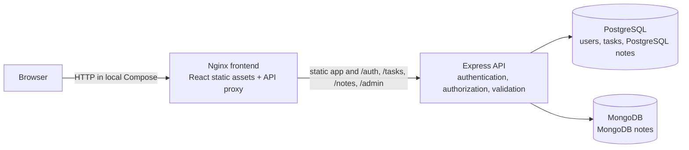

# TaskFlow

TaskFlow is a full-stack task manager built as part of the S3 Datacom training project. It provides account registration and login, role-aware access, task management, and notes backed by PostgreSQL or MongoDB. The React application communicates with an Express API; Docker Compose runs the production-built frontend, API, and both databases as an independent stack.

## Features

- Register and log in with email and password; keep a one-hour session in an HTTP-only cookie.
- Protect state-changing requests with a CSRF cookie and header.
- Create, view, update, and delete tasks. Tasks belong to the signed-in user; administrators can view all tasks.
- Search, filter, sort, and paginate tasks in the React interface.
- View the administrator account list when signed in as an administrator.
- Create, read, update, and delete notes using either the PostgreSQL or MongoDB adapter.
- View the interactive Swagger UI at `/api-docs/`.

## Technology

| Area | Technology |
| --- | --- |
| Frontend | React 18, TypeScript, Vite, React Router, Axios |
| API | Node.js 22, Express 5, Zod, JWT, bcryptjs |
| Authentication and security | HTTP-only session cookies, CSRF protection, Helmet, CORS, login rate limiting |
| Relational data | PostgreSQL 16, `pg` connection pool |
| Document data | MongoDB 7, MongoDB Node.js driver |
| Frontend serving | Nginx reverse proxy in the production Docker image |
| Tests | Vitest, React Testing Library, Node.js test runner |
| Local orchestration and CI | Docker Compose, GitHub Actions |

The package manifests currently identify both apps as version `1.0.0`; both packages are private and are not configured for publishing to npm.

## Project structure

```text
.
├── .github/workflows/ci.yml          # CI checks
├── assignments/                      # Training assignments and security notes
├── frontend/                          # React app, component tests, Vite config
├── project/                           # Earlier static student project
├── solutions/
│   ├── day-6-node-express/             # TaskFlow API, database scripts, tests, docs
│   ├── database-comparison/            # PostgreSQL/MongoDB notes comparison
│   ├── mongo/                          # MongoDB practice scripts
│   └── postgres/                       # PostgreSQL exercises and results
├── docker-compose.yml                 # Independent full-stack Compose deployment
├── CHANGELOG.md
└── README.md
```

The API's detailed test instructions are in [`solutions/day-6-node-express/docs/TESTING.md`](solutions/day-6-node-express/docs/TESTING.md). Architecture and deployment notes are in [`solutions/day-6-node-express/docs/ARCHITECTURE.md`](solutions/day-6-node-express/docs/ARCHITECTURE.md) and [`solutions/day-6-node-express/docs/DEPLOYMENT.md`](solutions/day-6-node-express/docs/DEPLOYMENT.md).

## Architecture



See the [architecture guide](solutions/day-6-node-express/docs/ARCHITECTURE.md) for request flow, the local Vite proxy, database responsibilities, and session details.

## Requirements

- Node.js 22.x and npm (the app supports Node 18+, but the current Vitest 4 test tools require Node 20+).
- Docker Engine with the Docker Compose v2 plugin for containerized application or integration testing.
- PostgreSQL 16 and MongoDB 7 for local development outside the full-stack Compose deployment.
- A browser for the frontend.

The Dockerfiles use pinned Node and Nginx image digests. Compose builds the frontend assets and serves them from Nginx.

## Environment variables

Never commit `.env` files or place server secrets in frontend build variables. The tracked examples contain non-production placeholders or fixed, test-only values.

| File | Purpose |
| --- | --- |
| `solutions/day-6-node-express/.env.example` | Local API and database connection settings; replace every placeholder with values for your local databases. |
| `frontend/.env.example` | Optional `VITE_API_BASE_URL`; leave empty to use the Vite development proxy. |
| `solutions/day-6-node-express/.env.test.example` | Fixed test-only connection targets required by the integration test guard. Do not use these for development or production data. |
| `.env.production.example` | Root Compose settings; copy only when a root `.env` does not already exist. |

The API reads `PORT`, `DATABASE_URL`, `PGPOOL_MAX`, `MONGODB_URI`, `MONGODB_DATABASE`, `JWT_SECRET`, `FRONTEND_ORIGIN`, `NODE_ENV`, and `ENABLE_SQL_INJECTION_DEMO`. Admin seeding also reads `ADMIN_EMAIL` and `ADMIN_PASSWORD`. The frontend reads `VITE_API_BASE_URL` at build time; it is public configuration, never a place for credentials.

For a new checkout's Compose stack, copy `.env.production.example` to the ignored root `.env`, replace all placeholders with unique values, and keep the file private. Use URL-safe random database passwords because Compose embeds them in connection URLs. Do not replace an existing `.env` while its named database volumes are in use; the database credentials must remain synchronized.

## Local development

### Backend

From the repository root:

```sh
cd solutions/day-6-node-express
npm ci
test -f .env || cp .env.example .env
```

Edit `.env` with your local PostgreSQL and MongoDB connection settings and a random `JWT_SECRET` of at least 32 characters. Start or provision **development-only** databases, then initialize the schema and start the API:

```sh
npm run db:init
npm start
```

Use `npm run dev` for Node's watch mode. The API listens on `PORT` (default `3000`). The database Compose file in this directory binds ports `5432` and `27017`; check for existing services before using it. Never initialize, seed, or test against production data.

For a disposable local database only, `npm run db:seed` inserts example task and note data. `npm run db:seed-admin` creates or updates an administrator using local `ADMIN_EMAIL` and `ADMIN_PASSWORD` values.

### Frontend

In another terminal, from the repository root:

```sh
cd frontend
npm ci
test -f .env || cp .env.example .env
npm run dev
```

The Vite development server is at `http://localhost:5173` and proxies API routes to `http://localhost:3000`. With the API and its databases running, open the frontend and register an account.

## Docker Compose

The root Compose file is a self-contained deployment. Its PostgreSQL and MongoDB services use private networking and their own named volumes; no database host ports are published. The API initializes its PostgreSQL schema before it starts. This stack does not reuse the separate training database volumes.

For a new checkout without a root `.env`:

```sh
cp .env.production.example .env
# Edit .env and replace each placeholder with a unique random value.
docker compose up --build -d
```

Open `http://localhost:8080`. Nginx serves the React app and forwards API requests over the private Compose network. Use these commands to inspect status and logs:

```sh
docker compose ps
docker compose logs --tail=100 frontend backend postgres mongodb
docker compose logs -f backend
```

Stop the stack and retain its data with `docker compose down`. `docker compose down -v` deletes this stack's named database volumes; use it only when intentionally removing that data. Full settings and deployment notes are in the [deployment guide](solutions/day-6-node-express/docs/DEPLOYMENT.md).

## URLs

| Mode | Frontend | API | Swagger UI |
| --- | --- | --- | --- |
| Local development | `http://localhost:5173` | `http://localhost:3000` (proxied by Vite) | `http://localhost:3000/api-docs/` |
| Root Docker Compose | `http://localhost:8080` | Same-origin paths proxied by Nginx; backend port is private | `http://localhost:8080/api-docs/` |

## API endpoint summary

The API's Swagger UI at `/api-docs/` documents request schemas, responses, cookie authentication, and CSRF requirements. The API runs on port 3000 in local development; in Compose use the frontend origin at port 8080.

| Method | Endpoint | Purpose | Authentication |
| --- | --- | --- | --- |
| `GET` | `/health` | Service health response. | No |
| `GET` | `/hello?name=...` | Greeting; uses `Guest` if `name` is omitted. | No |
| `GET` | `/auth/csrf` | Issue a CSRF token cookie and JSON token. | No |
| `POST` | `/auth/register` | Create a user and start a session. | No; CSRF token required |
| `POST` | `/auth/login` | Verify credentials and start a session. | No; CSRF token required |
| `GET` | `/auth/me` | Return the current user. | Yes |
| `POST` | `/auth/logout` | Clear the session cookie. | CSRF token required |
| `GET` | `/admin/users` | List accounts for administrators. | Admin |
| `GET`, `POST` | `/tasks` | List the caller's tasks, or create one. | Yes; CSRF for `POST` |
| `GET`, `PUT`, `DELETE` | `/tasks/:id` | Read, replace, or delete an owned task. | Yes; CSRF for writes |
| `GET`, `POST` | `/notes/postgres` | List or create PostgreSQL notes. | Yes; CSRF for `POST` |
| `GET`, `PUT`, `DELETE` | `/notes/postgres/:id` | Read, replace, or delete a PostgreSQL note. | Yes; CSRF for writes |
| `GET`, `POST` | `/notes/mongo` | List or create MongoDB notes. | Yes; CSRF for `POST` |
| `GET`, `PUT`, `DELETE` | `/notes/mongo/:id` | Read, replace, or delete a MongoDB note. | Yes; CSRF for writes |
| `GET` | `/dev/sql-injection-demo?name=...` | Development-only SQL lesson using dummy rows. | No; disabled in production and requires explicit opt-in |

All `POST`, `PUT`, `PATCH`, and `DELETE` requests must send the CSRF cookie value in the `X-CSRF-Token` header. Obtain it from `GET /auth/csrf`. Authenticated requests may use the session cookie or a bearer token; the frontend uses cookies. Task and note request/response schemas and common status codes are specified in Swagger.

## Authentication flow

1. The frontend requests `GET /auth/csrf`; the API returns a `csrfToken` and sets a readable `csrf_token` cookie.
2. The user registers or logs in. The frontend sends the CSRF cookie and matching `X-CSRF-Token` header.
3. The API verifies credentials, hashes new passwords with bcrypt, and sets a signed one-hour `s3_training_session` HTTP-only cookie.
4. The frontend sends credentialed requests. The API verifies the session and loads the account role from PostgreSQL; mutations also validate the CSRF cookie/header pair.
5. Logout clears the session cookie. Admin routes additionally require the `admin` role.

In production, session and CSRF cookies use `Secure`; both use `SameSite=Strict`. Keep frontend and API requests same-site, preferably same-origin through the Nginx proxy. The [architecture guide](solutions/day-6-node-express/docs/ARCHITECTURE.md) includes a sequence diagram.

## Database responsibilities

- **PostgreSQL:** user accounts and bcrypt password hashes, tasks and ownership, plus notes created through `/notes/postgres`. The idempotent schema and additive auth migration are under `solutions/day-6-node-express/db/`.
- **MongoDB:** notes created through `/notes/mongo`, stored in the `notes` collection.

The note endpoints intentionally provide parallel CRUD behavior over different databases. Tasks and accounts are not stored in MongoDB.

## Testing

Backend checks (from `solutions/day-6-node-express`):

```sh
npm test                 # HTTP/security tests; DB integration tests are skipped by default
npm run test:unit         # Backend unit tests
```

Backend integration checks use dedicated test-only databases and guarded ports/credentials:

```sh
cd solutions/day-6-node-express
test -f .env.test || cp .env.test.example .env.test
npm run db:test:up
npm run db:test:init
npm run test:integration
npm run db:test:down
```

Frontend checks (from `frontend`):

```sh
npm test
npm run typecheck
npm run build
```

GitHub Actions runs backend unit and HTTP tests, database integration tests with isolated PostgreSQL and MongoDB services, frontend component tests, the frontend type check, and a production build on pushes and pull requests. Neither package currently configures a lint script. See [`docs/TESTING.md`](solutions/day-6-node-express/docs/TESTING.md) for test scope and coverage details.

## Troubleshooting

- **Port 5432 or 27017 is already in use:** keep existing database services untouched. Point the API's local `.env` at the available database, or use the root Compose stack, which does not publish database ports.
- **Registration or login returns 403:** first call `GET /auth/csrf`, then send the returned token in `X-CSRF-Token` with the matching CSRF cookie.
- **Protected API returns 401:** verify that the browser is sending credentials, the session has not expired, and frontend/API requests are same-site. The session lasts one hour.
- **Browser reports a CORS error:** set `FRONTEND_ORIGIN` to the exact frontend origin (scheme, host, and port). Keep `credentials: true` and use the frontend's credentialed Axios client.
- **Backend fails at startup:** check `DATABASE_URL`, `MONGODB_URI`, `JWT_SECRET` (at least 32 characters), database health, and `docker compose logs backend postgres mongodb`.
- **Compose service is unhealthy:** inspect `docker compose ps` and `docker compose logs <service>`. Database data persists in named volumes across `docker compose down`.
- **Integration tests refuse the database URL:** use `.env.test.example` unchanged and the dedicated `npm run db:test:*` test project. The guard is intended to reject non-test targets.
- **API docs appear incomplete:** open `/api-docs/` on the same origin as the API and rebuild/restart the backend after updating the Swagger specification.

## Release and deployment

See [`CHANGELOG.md`](CHANGELOG.md), the [v1.0.0 release checklist](solutions/day-6-node-express/docs/RELEASE_CHECKLIST.md), and the [deployment guide](solutions/day-6-node-express/docs/DEPLOYMENT.md). No deployment, tag, or release is created by this repository documentation.
