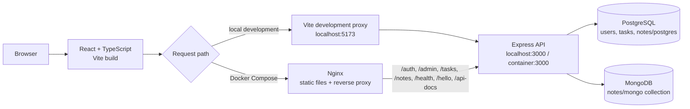
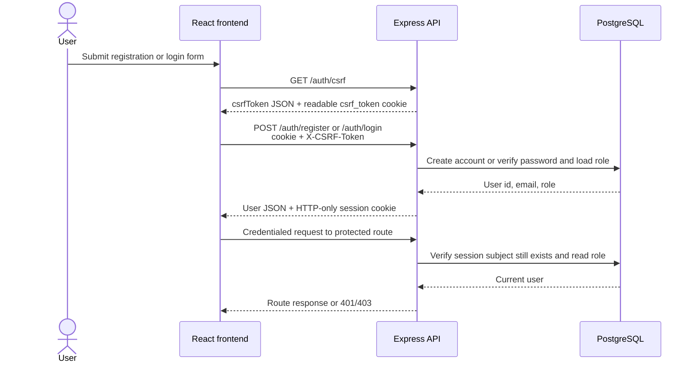

# TaskFlow architecture

TaskFlow is a browser client, an Express API, and two database adapters. PostgreSQL is the system of record for accounts and tasks; notes can be stored through either the PostgreSQL or MongoDB endpoint.

## Components and request flow

In local development, Vite serves the React app on `http://localhost:5173` and proxies API paths to the backend at `http://localhost:3000`. In root Docker Compose, Nginx serves the built app on port `8080` and proxies API requests to the backend service over the private `app` network. The backend and database ports are not published to the host by root Compose.

The frontend uses Axios with `withCredentials: true`. API middleware includes Helmet, credentialed CORS for the configured `FRONTEND_ORIGIN`, cookie parsing, JSON parsing, and CSRF validation. Zod schemas validate account, task, and note inputs. The repositories use PostgreSQL parameterized queries; the MongoDB adapter uses the official MongoDB driver.

## Authentication and request sequence

The session is a signed JWT with a one-hour lifetime. It is set as `s3_training_session` with `HttpOnly`, `SameSite=Strict`, and `Secure` when `NODE_ENV=production`. Authentication accepts this cookie or an `Authorization: Bearer ...` header. The React client uses the cookie flow. Admin authorization reads the role from PostgreSQL on each authenticated request.

`GET /auth/csrf` sets a separate one-hour `csrf_token` cookie that is intentionally readable by the browser client. For every `POST`, `PUT`, `PATCH`, and `DELETE`, middleware requires the matching `X-CSRF-Token` header. This applies even to routes that do not require a signed-in user, such as registration and login.

## Data ownership

| Data | Storage | Notes |
| --- | --- | --- |
| Accounts | PostgreSQL `users` table | Email, bcrypt password hash, role, creation time. |
| Tasks | PostgreSQL `tasks` table | Owner account id, title, notes, status, due date, timestamps. Regular users can access their own tasks; admins can read all tasks. |
| PostgreSQL notes | PostgreSQL `notes` table | CRUD through `/notes/postgres`. |
| MongoDB notes | MongoDB `notes` collection | CRUD through `/notes/mongo`; documents include timestamps. |

The task schema and additive account/ownership migration are in `../db/`. The Docker backend runs the idempotent initializer before starting the API. The MongoDB database and notes collection are created on first write.

## Failure handling and logs

The API returns a safe generic `500` response for uncaught request/database failures and logs structured request path/method plus safe error type/code fields. Database connection failures are also logged. Passwords, tokens, cookies, request bodies, and raw error messages are omitted. Docker Compose exposes service logs through `docker compose logs`.

## Deployment topologies

The supported self-contained topology is the root `docker-compose.yml`: Nginx, API, PostgreSQL, and MongoDB run on Compose networks with named database volumes. For a split frontend/API hosting setup, both origins must be HTTPS and same-site for the current `SameSite=Strict` cookie policy; set the exact frontend origin in `FRONTEND_ORIGIN` and the API origin in the frontend build-time `VITE_API_BASE_URL`. See [DEPLOYMENT.md](DEPLOYMENT.md).

The interactive OpenAPI documentation is served by the existing Swagger UI at `/api-docs/`; its specification is maintained in `../src/openapi.js` and mounted by the Express app.
